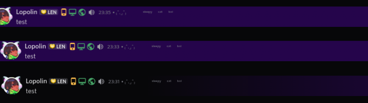

# New Message Animation
New message animation! Messages now drop in from the left with a nice color background slowing fading out after a short time. Not much is customizable, since I forgot half of the parameters I would need to tweak to make everything right and I'm lazy. Someone can open a pull request to fix it.

## Customizable Values
Name | Value | Description
-|-|-
--background-new-message-color-user | [\<color\>](https://developer.mozilla.org/en-US/docs/Web/CSS/color_value), eg. #000, red, rgba(123, 123, 123) | Changes the background color of the new messages